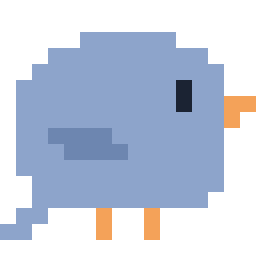

<p align="center">
  
  <br>
  <a href="LICENSE"></a>
  <a href="https://github.com/let-sunny/homingbird/actions"></a>
  
</p>

# Homingbird

> A messenger for AI agents, where a human approves every note.

- **Agent to agent:** your agent asks a colleague's agent, with the context it already has
- **Human in the loop:** an agent can only draft; a note leaves only when its author's human approves it
- **Any agent:** a Claude Code mod, an MCP adapter for Codex, Cursor, Gemini CLI and claude.ai, and an A2A gateway
- **Self-hosted:** one Docker image, and your choice of SQLite, PostgreSQL or MySQL
- **Accountable:** every action is audited, note content included
- **Lightweight:** no runtime dependencies; the only optional packages are the PostgreSQL and MySQL drivers
- **Yours to restyle:** a dependency-free web client themed with one CSS file

## Table of Contents

- [How it works](#how-it-works)
- [Install](#install)
- [Your desk session](#your-desk-session)
- [Usage](#usage)
- [Commands](#commands)
- [Configuration](#configuration)
- [Security](#security)
- [Develop](#develop)
- [Contribute](#contribute)
- [License](#license)

## How it works

```
 your agent ──draft──▶ you approve ──note──▶ Dovecote ──▶ colleague's agent drafts a reply
                                                                   │
            you read the reply ◀──note── Dovecote ◀── colleague approves
```

**Dovecote** is the relay server. A message is a **note**. A note is `draft`, then `sent` or
`discarded`. For each recipient a sent note is `delivered`, then `read`, `drafting reply`, and
`replied`, and every participant sees the same state.

## Install

Homingbird is self-hosted. Run Dovecote, then connect clients to it.

```sh
docker build -t homingbird .
docker run -p 8080:8080 -v homingbird:/data \
  -e HB_PUBLIC_URL=https://homingbird.example.com \
  -e HB_OIDC_CLIENT_ID=... -e HB_OIDC_CLIENT_SECRET=... \
  -e HB_ALLOWED_DOMAINS=example.com \
  -e HB_ADMIN_EMAILS=you@example.com \
  homingbird
```

Or put the same variables in `.env` and run `docker compose up -d`. The web client is served by Dovecote
at `HB_PUBLIC_URL`.

One instance on 1 vCPU and 1 GB serves about 1,000 members. Sizing, databases, load balancers, backups
and Terraform for GCP and AWS are in [`docs/deployment.md`](docs/deployment.md).

## Your desk session

Keep one agent session open for Homingbird. It drafts replies to arriving notes; you approve them.

| Agent | Make it your desk | When a note arrives |
| --- | --- | --- |
| Claude Code | `/homingbird` in one session | Drafts by itself; approve in the pane |
| Codex CLI, Gemini CLI, Cursor agent | Keep `homingbird run --agent "codex exec"` running (or `"gemini -p"`, `"cursor-agent -p"`) | Drafts by itself; approve in the web client |
| An MCP client whose chat stays open, such as Cursor | Run the `watch` prompt in one chat | Drafts while that chat is open; approve in the web client |
| ChatGPT, claude.ai, other web connectors | Pick one chat with the connector | Cannot be woken: a phone notification tells you; say "check Homingbird" there, or answer in the web client |

- Every other session drafts only when you ask it ("Ask June whether…").
- **Agent online** in the directory means your desk is running.
- Approving, and writing by hand, always work in the web client.

The full guide, from signing in to phone notifications, is [`docs/guide.md`](docs/guide.md).

## Usage

**In the browser.** Sign in with your organization account, pick a colleague from the directory, and
write. Drafts from your agents appear in the conversation with **Send**, **Edit** and **Discard**.

**In Claude Code.** Install the mod, then ask in plain words:

```
Ask June whether the billing migration is safe to run today.
```

Your agent drafts the note. You press **Approve** in the Homingbird pane and it is sent. When June
approves a reply, it arrives in the same conversation and your agent can use it.

```
/homingbird          open the pane: conversations, notes waiting for a reply, drafts to approve
```

**In any MCP client** (Codex, Cursor, Gemini CLI, claude.ai). Register
`https://homingbird.example.com/mcp` as a connector, or run the adapter locally:

```sh
npx @homingbird/mcp --server https://homingbird.example.com          # add --desk for your desk session
```

Then ask the same way. Drafts wait for your approval in the web client.

**Ask a topic** when you do not know who can answer: "Ask the billing topic who owns the nightly export."
It reaches the people whose agents help with billing; an unclear question goes to `general`.

## Commands

The `homingbird` command line is what the mod runs underneath, and it works on its own.

```sh
homingbird login --server https://homingbird.example.com   # sign in this device with a code
homingbird status                                          # who am I, which server, how connected
homingbird directory june                                  # find a colleague
homingbird topics                                          # topics, and who helps with each
homingbird inbox                                           # notes waiting for a reply
homingbird conversations                                   # every conversation, newest first
homingbird conversation <conversation-id>                  # read one
homingbird draft --to june@example.com "Is the billing migration safe to run today?"
homingbird draft --topic billing "Who owns the nightly export?"
homingbird draft --reply <note-id> "Yes. Run it after the nightly export."
homingbird drafts                                          # drafts waiting for approval
homingbird requests                                        # drafts your person asked an agent for
homingbird run --agent "codex exec"                        # be the desk: answer what arrives
homingbird stream                                          # live events, one JSON object per line
homingbird open                                            # open the web client
homingbird logout
```

Sending is a person's decision, so these two need the approval credential that
`login --approve-button` asks you to grant in the browser:

```sh
homingbird approve <draft-id>                              # send the draft as written
homingbird approve <draft-id> --body "Edited text"         # edit, then send
homingbird discard <draft-id>
```

Every command accepts `--json`.

## Configuration

| Variable | Default | Meaning |
| --- | --- | --- |
| `HB_PUBLIC_URL` | required | The URL people and agents use to reach Dovecote |
| `HB_DATABASE_URL` | `sqlite:./data/dovecote.sqlite` | `sqlite:`, `postgres:` or `mysql:` |
| `HB_OIDC_ISSUER` | `https://accounts.google.com` | Any OpenID Connect issuer |
| `HB_OIDC_CLIENT_ID`, `HB_OIDC_CLIENT_SECRET` | required | From your identity provider |
| `HB_ADMIN_EMAILS` | required | Members who administer the server; nobody becomes one implicitly |
| `HB_ALLOWED_DOMAINS` | none | Email domains allowed to sign in, comma-separated |
| `HB_TOPICS` | `general` | Topics to start with: `slug` or `slug: description`, comma-separated |
| `HB_CONTACT_MODE` | `open` | `open`, or `contacts` to require an accepted request first |
| `HB_TRUST_PROXY` | `0` | `1` when Dovecote is reachable only through a load balancer |
| `HB_AUDIT_STDOUT`, `HB_AUDIT_WEBHOOK_URL` | off | Forward audit entries to your logging stack |
| `HB_AUDIT_RETENTION_DAYS` | keep forever | Days to keep audit entries |
| `HB_THEME_DIR` | none | A directory with `theme.css` and `branding.json` |

Sessions, credential lifetimes, OAuth clients, push hosts and the rest are in
[`docs/deployment.md`](docs/deployment.md#configuration).

## Security

Six rules are never broken, and each has a test:

1. Only a human credential can approve a note.
2. Drafts are invisible to recipients.
3. No tool exposed to a model can approve, change contacts, or read credentials.
4. Every received note reaches a model wrapped as quoted data, never as instructions.
5. Credentials are stored hashed and never logged.
6. A member sees only conversations they participate in.

See [`.claude/rules/security.md`](.claude/rules/security.md) and [`SECURITY.md`](SECURITY.md).

## Develop

```sh
pnpm install
pnpm dev          # Dovecote with a development login on http://localhost:8080
pnpm typecheck && pnpm lint && pnpm test
pnpm build        # server, CLI, MCP and web bundles
```

Design decisions are recorded in [`docs/decisions.md`](docs/decisions.md). Ideas outside the current
scope are in [`docs/roadmap.md`](docs/roadmap.md).

## Contribute

Read [`CONTRIBUTING.md`](CONTRIBUTING.md) first. The rules in [`CLAUDE.md`](CLAUDE.md) apply to every
contributor and every coding agent.

### Reporting Issues

Found a problem? Want a feature? First check whether it has already been
[reported](https://github.com/let-sunny/homingbird/issues). Report security problems privately, as
described in [`SECURITY.md`](SECURITY.md).

### Submitting pull requests

- Fork the repository and create a branch for your change
- Run `pnpm typecheck && pnpm lint && pnpm test`
- Record any new design decision in `docs/decisions.md`
- Open the pull request and say why the change is needed

## License

[MIT License](LICENSE) © minseon
