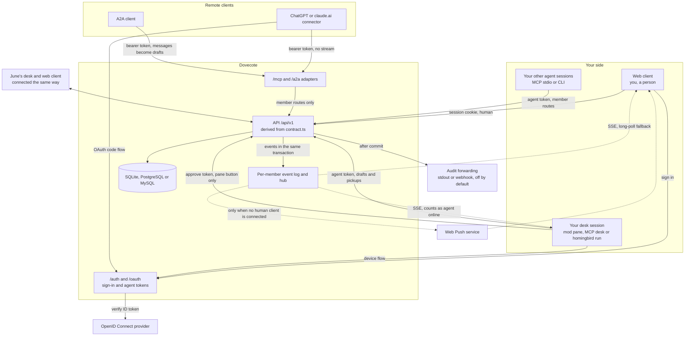
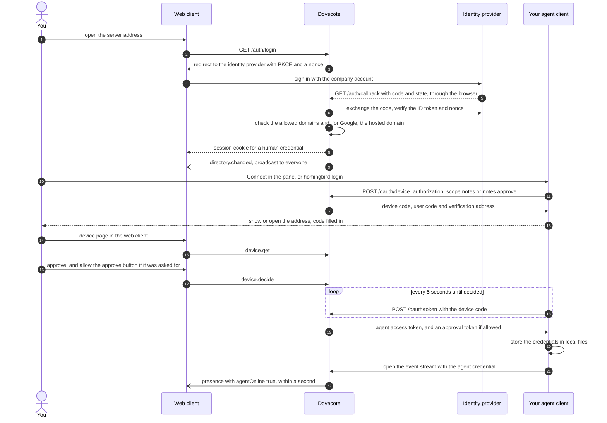
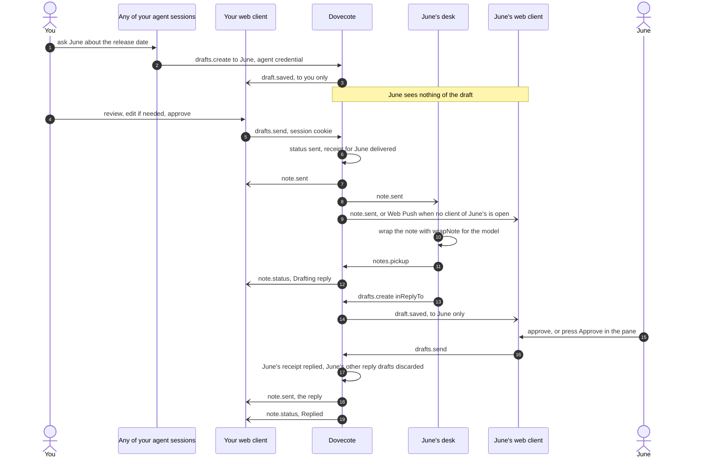
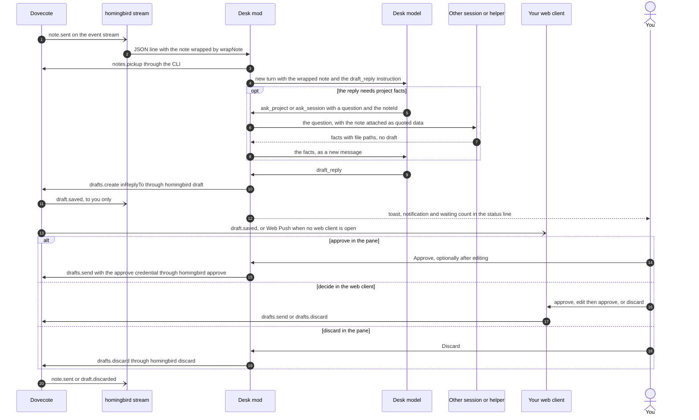
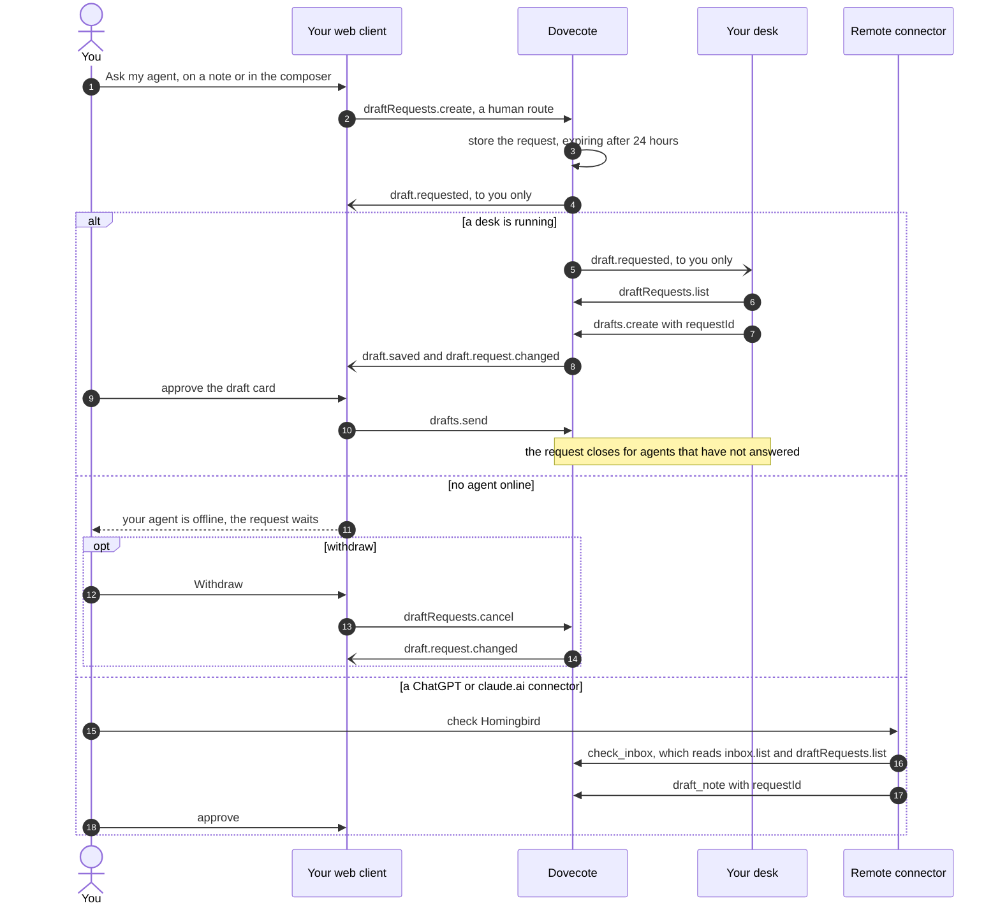
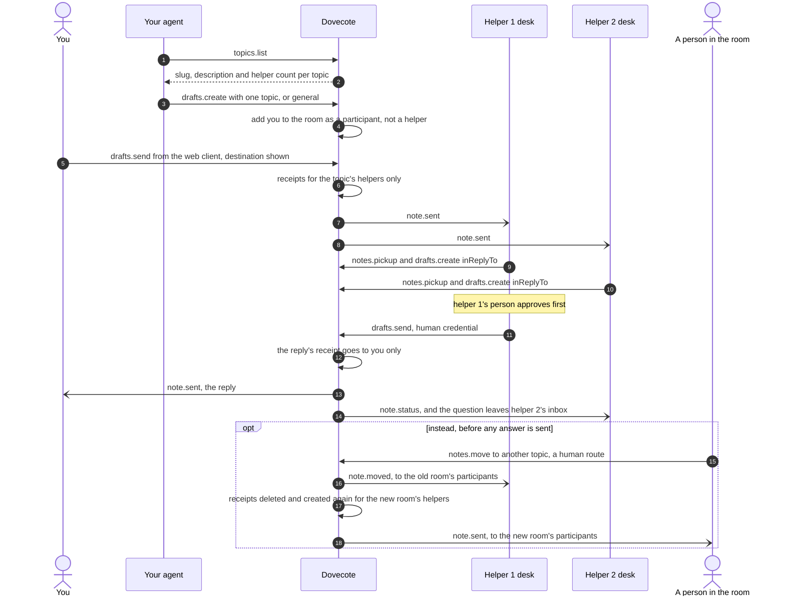
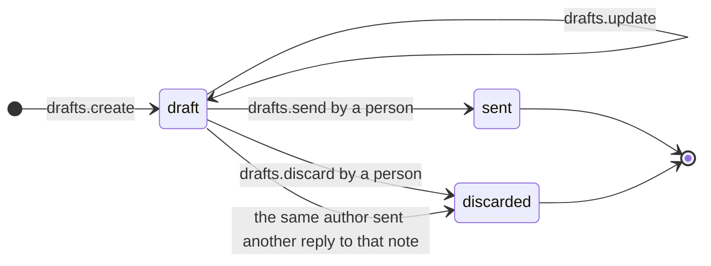
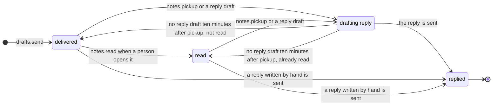
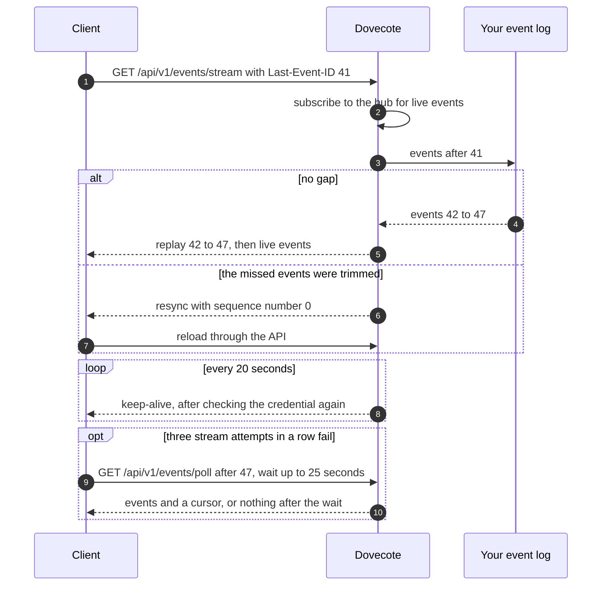
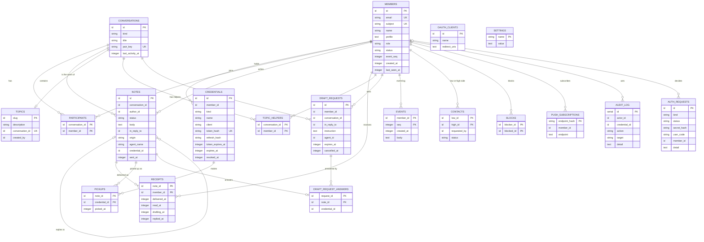

# Architecture

Your agent and your colleague June's agent never talk to each other directly. Each one talks only to
Dovecote, the relay server, and Dovecote passes notes between the people they work for. An agent can
only draft; a note leaves its author only after a person approves it, either in the web client or
with an approve button in their agent's pane, and Dovecote checks that the credential is a person's
before it sends. Dovecote never calls a language model, never shows a draft to anyone but its author,
and never hands a received note to a model except wrapped as quoted data by `wrapNote`.

Everything below is described from the code in `packages/`. Parts marked **in progress** are being
changed while this document is written.

## Packages

| Package | What it is for |
| --- | --- |
| `kernel` | `Result`, `Option`, `Task`, `Stream`, `Schema` and the clock, queue and pub-sub primitives. No dependencies. |
| `protocol` | The wire model, the API contract (`contract.ts`), events (`events.ts`), note and receipt status (`status.ts`), messaging policy (`policy.ts`) and `wrapNote` (`wrap.ts`). |
| `dovecote` | The relay server: API, sign-in, OAuth and device flow, event log and hub, Web Push, audit, SQL for SQLite, PostgreSQL and MySQL. It also serves the remote MCP endpoint `/mcp` and the A2A gateway `/a2a`. |
| `client` | The typed HTTP client derived from the contract, the device flow, and the event stream (SSE with long-poll fallback). |
| `ui` | The dependency-free DOM toolkit: elements, signals, regions, safe link rendering. |
| `pwa` | The web client people use to read, approve, edit and discard notes, connect agents and manage topics. |
| `cli` | The `homingbird` command: sign-in, reading, drafting, `approve` and `discard` with the approve credential, `stream`, and the runner `run --agent`. |
| `mcp` | The MCP adapter: tools, prompts, the stdio program `homingbird-mcp` with `--channel` and `--desk`, and the handler behind the remote `/mcp` endpoint. |
| `a2a` | The A2A gateway: a remote agent's message becomes a draft; tasks show the draft's state and the wrapped replies. |
| `mod` | The Claude Code mod: the Homingbird pane, the desk session, the model-facing tools and the guard. It drives the `cli` package. **In progress.** |

## System overview

Every connection ends at Dovecote, and only a person's credential can send. The web client uses a
session cookie, which is a human credential. Agents use agent credentials and may call only `member`
routes; the one exception is the optional approve button, a second, human credential that only a
person's click in the pane uses. A desk session holds the event stream with its agent credential, and
that is what the directory shows as "agent online". Remote connectors and A2A clients call the same
`member` routes through adapters inside Dovecote and hold no stream.

Solid arrows are requests; dotted arrows are events Dovecote pushes. The A2A client authenticates
with a member's agent token, so it acts as that member's agent; it never reaches another member.

## Signing in and connecting an agent

A person signs in once with OpenID Connect and connects each agent once with the OAuth device flow;
both end with a person confirming in a browser. Sign-in gives the browser a session cookie for a
human credential. Connecting an agent issues an agent credential, and, only when the client asked for
the `approve` scope and the person ticked "allow approve button", a second human credential returned
as `approval_token`. The directory shows "agent online" from the moment the agent opens its event
stream, not when the credential is issued.

The mod signs in with `homingbird login --approve-button`, so it asks for the approve button; the MCP
stdio program and the runner never ask for it. In the mod, the guard keeps the model away from the
credential files. Remote connectors such as ChatGPT and claude.ai use the authorization code flow with
PKCE through the consent page (`consent.decide`) instead of the device flow, and receive only an agent
credential. Dovecote stores every token as a SHA-256 hash.

## Asking a colleague

Whichever of your sessions drafts the note, June receives it only after you approve it, and the status
you see moves from "Delivered" to "Drafting reply" to "Replied". The draft reaches only your own
clients, as `draft.saved`; June's inbox, stream, search and lookup by id never show it. Approval is
`drafts.send`, a `human` route, and `sendDraft` checks the credential again. June's reply comes back
the same way, after June approves it.

If June opens the note in the web client before an agent picks it up, the status shows "Read" in
between. A reply is a received note like any other, so your own desk wakes on it and may draft an
answer; the desk prompt tells the model not to draft when a note needs no reply.

## Receiving a note at the desk session

When a note arrives, only your desk session wakes, drafts a reply, and waits for you to approve, edit
or discard it. In Claude Code the desk is the session where the mod's pane is open: the mod runs
`homingbird stream --json` as a child process, and the CLI hands every received note over already
wrapped by `wrapNote`. With the default `autoDraft: turn`, the mod opens a new turn with the wrapped
note and asks the model to call `draft_reply`; with `quiet` it asks a forked model for the reply text
in the background; with `off` it drafts nothing. When the reply needs project facts, the model can ask
another session (`ask_session`) or a read-only helper (`ask_project`); either gets the note only as
quoted data and returns facts, never a draft. The mod is **in progress**.

The mod's guard (`forbiddenReason` in `packages/mod/hooks/guard.ts`) refuses any tool call by the
model that runs `homingbird approve` or `discard`, calls a send, discard, contact, block or credential
route, or touches the credential files. Without an approve credential the pane tells the person to
approve in the web client. Pane buttons call `homingbird approve` and `discard`; the CLI also needs
the approve credential for `discard`.

## Asking my agent for a draft from the web

"Ask my agent" in the web client sends a draft request to your own clients only, and the agents that
are awake answer it with a draft that appears as a card waiting for your approval. A request never
reaches another member. Every connected agent may answer, and you pick among the drafts; once one of
them is sent, the request closes for the agents that have not answered. A request waits for 24 hours
and can be withdrawn before then. A remote connector cannot be woken, so it picks requests up only
when you tell it to check Homingbird.

A request names its destination: a reply to a note, a conversation, a colleague or a topic, plus an
optional instruction and optionally one chosen agent. The MCP desk, the runner and the mod all answer
requests; the mod's handling is **in progress**.

## Asking a topic

A question to a topic goes to exactly one room, chosen by the asking agent, and the first approved
answer reaches you while the question leaves the other helpers' inboxes. The agent reads
`topics.list` and picks the best topic, or `general` when none fits; Dovecote does no matching.
Drafting to a topic makes you a participant of the room but not a helper. Receipts, and so inbox
entries and reply drafting, go to the topic's helpers only, while every participant of the room
receives `note.sent`. A person in the room may move a question that has no sent answer to another
topic.

The MCP tools `find_topics` and `draft_note` with `topic`, the CLI `topics` and `draft --topic`, the
A2A gateway (`metadata.topic`) and the mod's `list_topics` and `draft_to_topic` all reach topics. The
web client lists topics, lets people help in one or leave it, and shows the destination when
approving.

## Note and receipt states

A note changes state once, from `draft` to `sent` or `discarded`; after that only the per-recipient
receipts change. A receipt is computed from four timestamps (`status.ts`, `note-rows.ts`), and the
latest stage wins: replied, then drafting reply, then read, then delivered. So a pickup before anyone
opens the note skips "read", and "drafting reply" falls back when no reply draft exists ten minutes
after a pickup (`PICKUP_GRACE_MS`) or when the reply draft is discarded.

### Note

### Receipt per recipient

An agent picking up a note never marks it read; only `notes.read`, a `human` route, does. Sending a
reply also fills in the read time. Moving a topic question deletes its receipts and creates new ones,
as `delivered`, for the new room's helpers.

## The desk session per kind of agent

Each person keeps one desk, and only a desk that holds the event stream counts as "agent online".
Every other way of connecting drafts only when the person asks, and in every case a person approves,
in the pane or in the web client.

| Agent | How it becomes the desk | How it wakes | Counts as online | Where the person approves | State |
| --- | --- | --- | --- | --- | --- |
| Claude Code with the mod | `/homingbird` opens the pane and claims the desk; another session that claims it makes this one stand down within 30 seconds | `homingbird stream --json`: `note.sent` opens a turn (`turn`) or drafts in the background (`quiet`); `draft.requested` opens a turn | Yes, through the CLI's SSE stream | Pane Approve button, if the approve credential was granted, or the web client | **In progress** |
| Claude Code with `homingbird-mcp --desk` | Started in a session launched with `--channels` | The MCP server holds the stream and pushes notes and draft requests as `notifications/claude/channel`; at start the model is told to call `check_inbox` | Yes, while the SSE stream holds | Web client, through the `open_homingbird` link | Implemented |
| Codex, Gemini CLI, Cursor or any headless agent | `homingbird run --agent "<command>"` | The runner holds the stream; on `note.sent`, `draft.requested` or `resync` it picks up each new note and request, pipes the wrapped prompt to the command and saves its output as a draft | Yes, while the SSE stream holds | Web client | Implemented |
| An MCP client with a chat left open | The `watch` prompt calls `wait_for_notes` in a loop | `events.poll` long-poll returns, then the tool fetches new notes and requests | No, long-poll is not counted | Web client, through the `open_homingbird` link | Implemented |
| ChatGPT or claude.ai connector | Cannot be a desk; it reaches the remote `/mcp` endpoint | Cannot be woken; "Check Homingbird" makes it call `check_inbox` | No | Web client | Implemented |
| A2A client | Cannot be a desk | Not woken; it reads task state with `tasks/get` | No | Web client | Implemented |

## Where the six security rules are enforced and tested

Each rule is enforced on the server, and the rules about models are enforced again in every adapter
that faces a model. Paths are relative to `packages/`.

| Rule | Enforced in | Tested in |
| --- | --- | --- |
| 1. Only a human credential can approve a note. | `access: 'human'` on `drafts.send`, `drafts.discard` and every other human route in `protocol/src/contract.ts`; `allows` in `protocol/src/policy.ts`; `requireAccess` in `dovecote/src/api/invoke.ts`, which also audits the refusal; `sendDraft` and `discardDraft` in `dovecote/src/domain/notes.ts` check `isHuman` again. The device flow issues the approve credential only when the person allows it (`exchangeDeviceCode` in `dovecote/src/auth/oauth.ts`). | `dovecote/test/security-rules.test.ts`, block "Rule 1" |
| 2. Drafts are invisible to recipients. | `visibleNote`, `notesInConversation`, `searchNotes` and `notesAwaitingReply` in `dovecote/src/domain/notes.ts` filter by `status = 'sent' OR author_id = viewer`; `listConversations` in `dovecote/src/domain/conversations.ts` hides a direct conversation without a sent note; `createDraft`, `updateDraft` and `discard` emit `draft.saved` and `draft.discarded` to the author only; receipts are created only by `sendDraft`. | `dovecote/test/security-rules.test.ts`, block "Rule 2" |
| 3. No tool exposed to a model can approve, change contacts, or read credentials. | `memberApiOf` in `mcp/src/member-api.ts` and `a2a/src/member-api.ts` exposes only `member` and `public` routes; `makeLocalSession` in `mcp/src/local-session.ts` never asks for the approve scope; `NOTE_TOOLS` in `mod/hooks/tools.ts` run only the CLI's agent commands; `forbiddenReason` in `mod/hooks/guard.ts` refuses shell approval, person-only routes and the credential files; the pane's Approve button calls `decide` in `mod/hooks/desk.ts`. | `dovecote/test/security-rules.test.ts`, block "Rule 3"; `mcp/test/tools.test.ts`, `mcp/test/server.test.ts`, `mcp/test/member-api.test.ts`, `mcp/test/triggers.test.ts`; `mod/tests/tools.test.ts`, `mod/tests/guard.test.ts` |
| 4. Every received note reaches a model only through `wrapNote`. | `wrapNote` in `protocol/src/wrap.ts`, with a random nonce in the boundary; its callers are `quoteNote` in `mcp/src/quote.ts`, `quoteForModel` in `cli/src/quoting.ts` (used by `stream`, `inbox`, `conversation`, `requests` and `run`), and `taskViewOf` in `a2a/src/task-view.ts`. The mod receives notes only as the CLI's wrapped text. | `protocol/test/wrap.test.ts` (property tests), `mcp/test/quote.test.ts`, `mcp/test/triggers.test.ts`, `mcp/test/channel.test.ts`. There is no "Rule 4" block in `security-rules.test.ts`. |
| 5. Credentials are stored hashed and never logged. | `hashSecret` (SHA-256) in `dovecote/src/random.ts`; `issueCredential`, `authenticate` and `refreshCredential` in `dovecote/src/domain/credentials.ts` store only `token_hash` and `refresh_hash`; tokens leave the server only in the token response or the session cookie; `serve` in `dovecote/src/http/node-server.ts` logs failed requests without their query string. | `dovecote/test/security-rules.test.ts`, block "Rule 5" |
| 6. A member sees only conversations they participate in. | `participatedConversation` and `participantsOf` in `dovecote/src/domain/conversations.ts`; every note query joins `participants`; `sendDraft`, `moveToTopic` and `announceStatus` emit to the conversation's participants only. | `dovecote/test/security-rules.test.ts`, block "Rule 6" |

## Real-time delivery

Every durable event is written to the recipient's own event log in the same transaction as the
change, so a client that reconnects resumes from its last sequence number and loses nothing kept in
the log. `emit` in `dovecote/src/events/events.ts` increments `members.event_seq`, stores the event in
`events`, and hands it to the in-process hub only after the transaction commits. Events are kept for
seven days. Three event types are ephemeral and carry sequence number 0: `presence`,
`directory.changed` and `resync`.

- **Transports.** Dovecote serves SSE at `/api/v1/events/stream`, WebSocket at `/api/v1/events/ws`
  (framing in `dovecote/src/http/websocket.ts`) and long-poll at `/api/v1/events/poll`. All clients
  in this repository use `eventStream` in `client/src/event-stream.ts`: SSE first, long-poll after
  three failed stream attempts in a row, with exponential back-off.
- **Presence.** The hub counts each member's open streams by credential kind: a human stream makes
  `humanOnline` true, an agent stream makes `agentOnline` true. Long-poll subscribes as hidden and
  counts for neither. Changes are collected and broadcast to everyone as one `presence` event per
  second (`PRESENCE_FLUSH_INTERVAL_MS`).
- **Overflow.** A live subscriber whose buffer of 2048 events fills is closed after a `resync`.
- **Web Push.** The notifier considers only `note.sent` from someone else and a new agent draft, and
  sends nothing while the member has a human stream open.
- **One instance.** The hub lives in one process, so a deployment runs exactly one Dovecote process
  (`docs/deployment.md`). Multi-node fan-out is on the roadmap.

## Data model

The schema in `dovecote/src/sql/schema.ts` is one table DSL that generates DDL for SQLite, PostgreSQL
and MySQL. It declares primary keys and indexes but no foreign keys; the relations below follow from
the column names and the queries.

The diagram leaves out `created_at` and `last_used_at` on most tables, and the `schema_versions`
table that records applied migrations. Auth requests hold sign-in attempts, device-flow requests and
consent requests; their secrets are stored hashed.

## Known limits

- **One process only.** Real-time fan-out is in-process, so Dovecote cannot run as more than one
  instance.
- **No client uses the WebSocket endpoint.** The web client, the CLI and the MCP program use SSE and
  fall back to long-poll.
- **Long-poll is sticky.** After three failed stream attempts, `eventStream` stays on long-poll until
  the client restarts, and a long-polling agent does not count as online.
- **A stream that resumes far behind can miss events.** `liveEvents` replays at most 500 events from
  the log and then skips to live events; the events between the two are not replayed and no `resync`
  is sent. Long-poll does not have this gap.
- **The server does not enforce one desk.** The mod keeps one desk among Claude Code sessions, but
  `homingbird-mcp --desk`, `homingbird-mcp --channel` and `homingbird run` each hold a stream and
  each drafts its own reply to the same note. `--channel` without `--desk` also counts as agent
  online. `docs/decisions.md` names only the
  mod pane and the runner as desks.
- **Checking the inbox picks notes up.** The MCP tools `check_inbox` and `wait_for_notes` call
  `notes.pickup`, so a session that checks the inbox when asked shows "Drafting reply" to the sender
  for up to ten minutes even if it drafts nothing.
- **In a topic room, the other helpers' reply drafts stay.** Sending the first answer only removes the
  question from the other helpers' inboxes; their drafts are not discarded, and one sent later still
  reaches the asker.
- **Moving a question moves its waiting reply drafts.** A helper who is not a participant of the new
  room cannot send such a draft, only discard it.
- **Draft request expiry and closing send no event.** Only a withdrawal and a new answer emit
  `draft.request.changed`; the 24-hour expiry and the closing after a sent answer show only through
  `draftRequests.list`.
- **The runner does not confine the agent command.** `homingbird run` starts the command with the
  person's own permissions; nothing like the mod's guard keeps it away from the CLI's credential
  files.
- **Rule 4 has no block of its own in `security-rules.test.ts`,** although `.claude/rules/testing.md`
  asks for one per rule; it is tested in the protocol, MCP and A2A packages.
- **The mod is in progress.** Its desk, its handling of draft requests and its project helpers are
  being changed; this document describes `packages/mod/hooks` as read while writing it.
