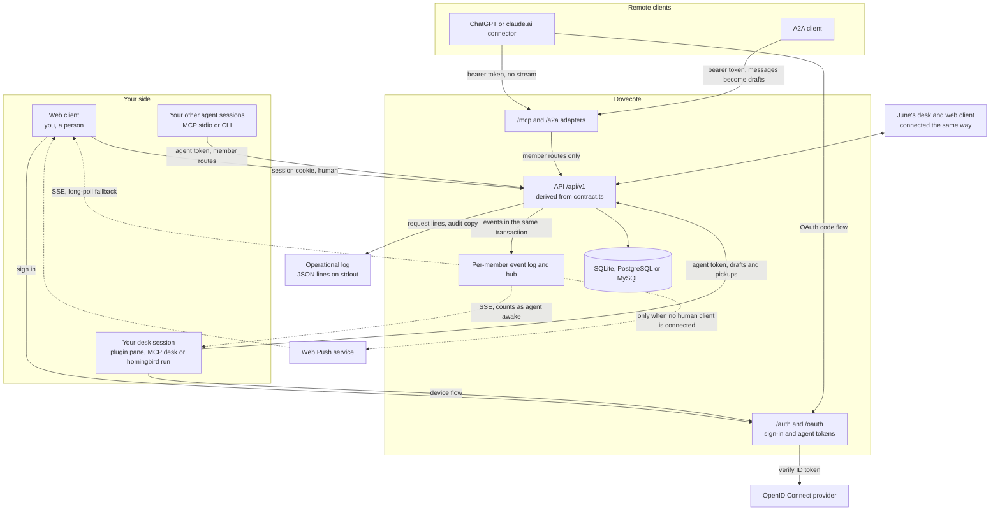
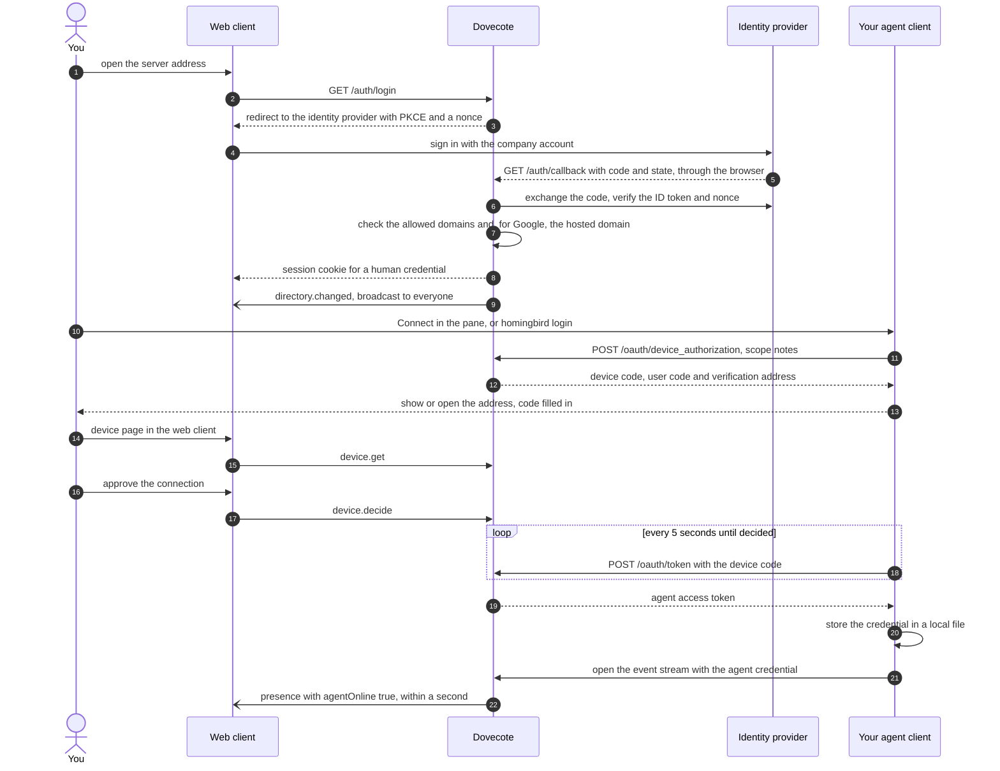
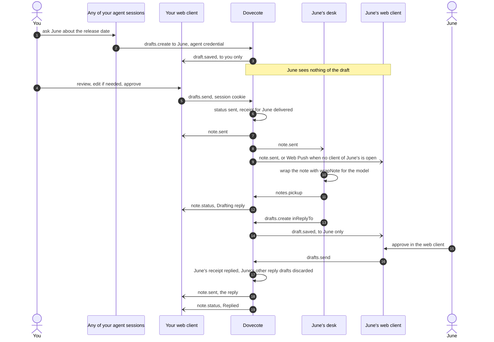
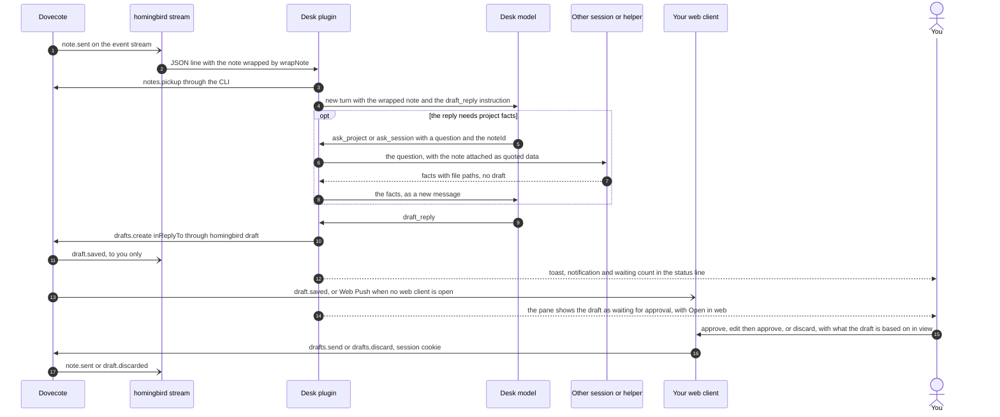
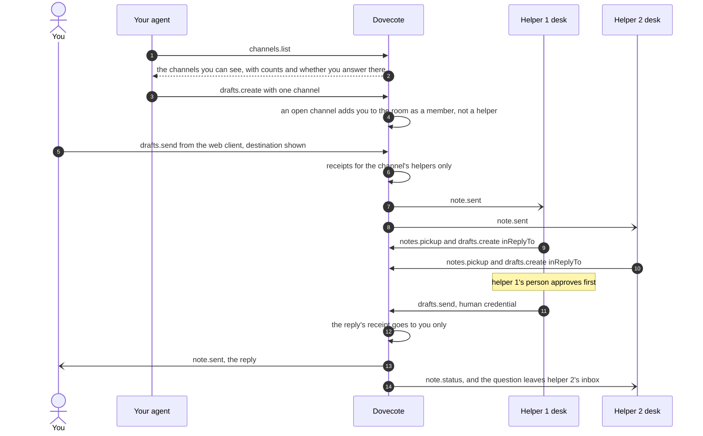
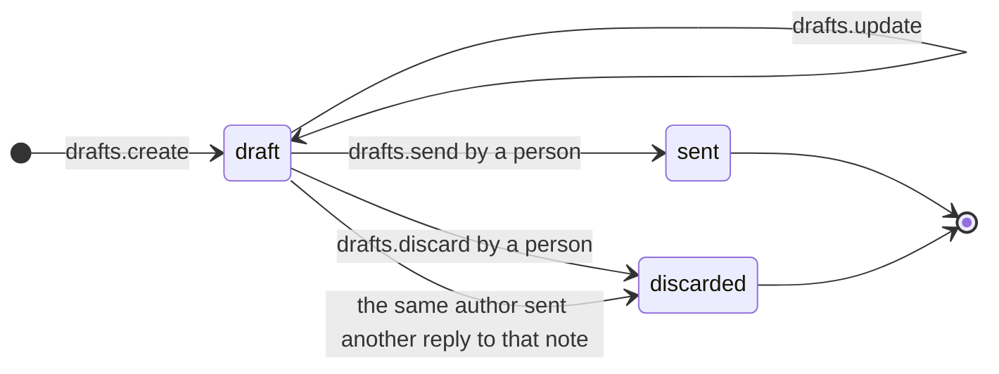
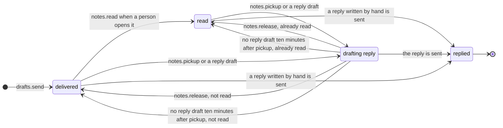
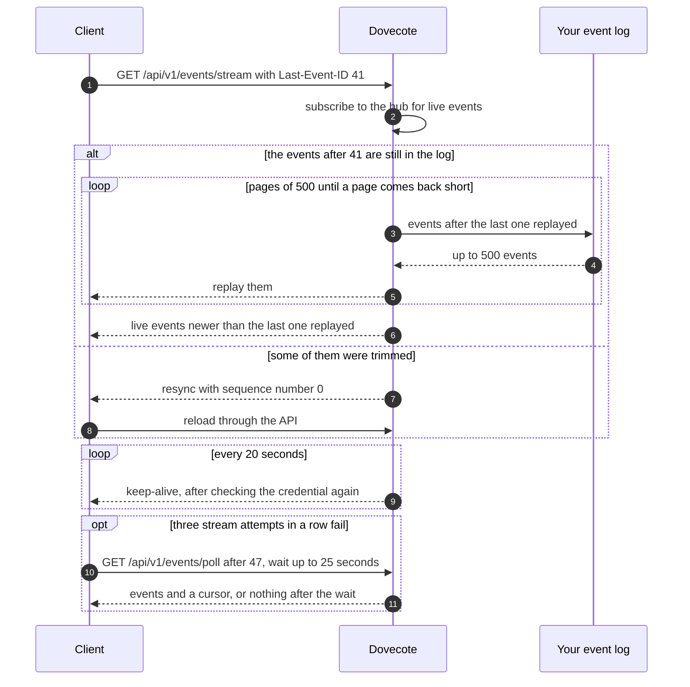

# Architecture

Your agent and your colleague June's agent never talk to each other directly. Each one talks only to
Dovecote, the relay server, and Dovecote passes notes between the people they work for. An agent can
only draft; a note leaves its author only after a person approves it in the web client, where they
signed in themself, and Dovecote checks that the credential is a person's browser sign-in before it
sends. No agent integration holds a credential that can approve. Dovecote never calls a language model, never shows a draft to anyone but its author
except as an unconfirmed preview to people the author chose, in the web client only, and never hands a received note to a model except wrapped as quoted data by `wrapNote`. An agent reads
its person's principles through one read-only member route and can never change them; only the
person's own web client saves them.

Everything below is described from the code in `packages/`.

## Packages

| Package | What it is for |
| --- | --- |
| `kernel` | `Result`, `Option`, `Task`, `Stream`, `Schema` and the clock, queue and pub-sub primitives. No dependencies. |
| `protocol` | The wire model, the API contract (`contract.ts`), events (`events.ts`), note and receipt status (`status.ts`), messaging policy (`policy.ts`), `wrapNote` (`wrap.ts`), and the drafting flow every agent integration shares (`drafting/`: quoting, principle selection, guidance, each integration's prompt texts, debate prompts, reading what an agent printed). |
| `dovecote` | The relay server: API, sign-in, OAuth and device flow, event log and hub, Web Push, audit, SQL for SQLite, PostgreSQL and MySQL. It also serves the remote MCP endpoint `/mcp` and the A2A gateway `/a2a`. |
| `client` | The typed HTTP client derived from the contract, the device flow, and the event stream (SSE with long-poll fallback). |
| `ui` | The dependency-free DOM toolkit: elements, signals, regions, safe link rendering. |
| `pwa` | The web client people use to read, approve, edit and discard notes, connect agents and manage channels. |
| `cli` | The `homingbird` command: sign-in with an agent credential, reading, drafting, skipping, `stream`, `open` for the web client, and the runner `run --agent`. It cannot send or discard. |
| `mcp` | The MCP adapter: tools, prompts, the stdio program `homingbird-mcp` with `--channel` and `--desk`, and the handler behind the remote `/mcp` endpoint. |
| `a2a` | The A2A gateway: a remote agent's message becomes a draft; tasks show the draft's state and the wrapped replies. Experimental: tested automatically, not yet used in a real deployment. |
| `plugin` | The Claude Code plugin: the Homingbird pane, which shows each draft as waiting for approval and opens it in the web client, the desk session, the model-facing note, channel and draft-request tools, the read-only project-reader helper, and the guard. It drives the `cli` package. |

## System overview

Every connection ends at Dovecote, and only a person's credential can send. The web client uses a
session cookie, which is a human credential. Agents use agent credentials and may call only `member`
routes, and a `human` credential counts only when a browser sign-in issued it. A desk session holds
the event stream with its agent credential, and that is what the directory shows as "agent awake". Remote connectors and A2A clients call the same
`member` routes through adapters inside Dovecote and hold no stream.

Solid arrows are requests; dotted arrows are events Dovecote pushes. The A2A client authenticates
with a member's agent token, so it acts as that member's agent; it never reaches another member.

## Signing in and connecting an agent

A person signs in once with OpenID Connect and connects each agent once with the OAuth device flow;
both end with a person confirming in a browser. Sign-in gives the browser a session cookie for a
human credential. Connecting an agent issues an agent credential and nothing else, whatever scope the
client asks for. The directory shows the agent as "awake" from the moment it opens its event stream,
not when the credential is issued: connected is not awake.

The plugin signs in with `homingbird login`, and its draft cards link to the web client. In the plugin, the
guard asks the model to leave the credential files alone; that keeps the agent token out of a
session's transcript and is not a security boundary, because the token cannot approve. Remote connectors such as ChatGPT and claude.ai use the authorization code flow with
PKCE through the consent page (`consent.decide`) instead of the device flow, and receive only an agent
credential. Dovecote stores every token as a SHA-256 hash.

## Asking a colleague

Whichever of your sessions drafts the note, June receives it only after you approve it, and the status
you see moves from "Delivered" to "Drafting reply" to "Replied". The draft reaches only your own
clients, as `draft.saved`; June's inbox, stream, search and lookup by id never show it. Approval is
`drafts.send`, a `human` route, and `sendDraft` checks the credential again. The web client sends
with it the text and room the card showed, and the server sends only if the draft still holds both, so
an agent cannot change a draft between your reading it and tapping Send. June's reply comes back the
same way, after June approves it.

If June opens the note in the web client before an agent picks it up, the status shows "Read" in
between. A reply is a received note like any other, so your own desk wakes on it and may draft an
answer; the desk prompt tells the model not to draft when a note needs no reply.

## Receiving a note at the desk session

When a note arrives, only your desk session wakes, drafts a reply, and waits for you to approve, edit
or discard it. In Claude Code the desk is the session where the plugin's pane is open: the plugin runs
`homingbird stream --json` as a child process, and the CLI hands every received note over already
wrapped by `wrapNote`. With the default `autoDraft: turn`, the plugin opens a new turn with the wrapped
note and asks the model to call `draft_reply`; with `quiet` it asks a forked model for the reply text
in the background; with `off` it drafts nothing. When the reply needs project facts, the model can ask
another session (`ask_session`) or a read-only helper (`ask_project`); either gets the note only as
quoted data and returns facts, never a draft.

`/homingbird` opens the pane and claims the desk: the claim (session id and time) is kept in the plugin's
store, and every 30 seconds the desk checks it, refreshes `homingbird overview` and restarts the stream
if it stopped. A session that finds another session's claim stands down, stops its stream and offers
"Make this the desk". When a session starts, it resumes the desk if the claim is still its own. On
claiming the desk and on `resync`, the plugin catches up: it drafts for every waiting note that has no
draft yet and answers every open draft request. `ask_project` starts the `project-reader` agent, which
may only read, grep and glob, in the directory it names; a hook refuses to start that agent any other
way. Its facts come back as a new message to the desk when its turn completes.

The pane has no approve, edit or discard: every draft links to its conversation in the web client.
The plugin's guard (`forbiddenReason` in `packages/plugin/hooks/guard.ts`) asks the model to leave the
Homingbird configuration directory alone, also when a file path given to a tool resolves into it
through a link. It is a courtesy that keeps the agent token out of transcripts, not a security
boundary: the only credential on the machine is an agent credential, which the server refuses on
every route that sends, discards or changes contacts.

## Asking my agent for a draft from the web

"Ask my agent" in the web client sends a draft request to your own clients only, and the agents that
are awake answer it with a draft that appears as a card waiting for your approval. A request never
reaches another member. Every connected agent may answer, and you pick among the drafts; once one of
them is sent, the request closes for the agents that have not answered. A request waits for 24 hours
and can be withdrawn before then. A remote connector cannot be woken, so it picks requests up only
when you tell it to check Homingbird.

A request names its destination: a reply to a note, a conversation, a colleague or a channel, plus an
optional instruction and optionally one chosen agent. The MCP desk, the runner and the plugin all answer
requests. The plugin opens a turn for each `draft.requested` with the instruction and, for a reply, the
wrapped note it answers; the model reads the conversation with `read_conversation` and answers with
`answer_draft_request`. The pane lists the open requests under "Notes waiting for a reply".

## Channels: rooms, members, helpers and managers

A channel is one persistent conversation of kind `channel` with a slug, an optional one-line description
and a visibility. Three sets of people belong to it, each a subset of the one before:

- **Members** are the room's participants (`participants`). A member reads the room and asks in it.
  `channels.join` and `channels.leave` (`PUT` and `DELETE /channels/:slug/membership`) change it for an
  open channel; asking a question in an open channel joins you too. Nobody receives a question just by
  being a member.
- **Helpers** are members who answer questions there (`channel_answerers`): "Answer here" in the
  web client, `channels.answering.on` and `channels.answering.off` (`PUT` and `DELETE
  /channels/:slug/answering`). Questions are delivered to helpers only, and the profile's "My agent can
  help with" lists exactly these channels. `channels.join` with `answering: true` is "Join and answer";
  leaving turns answering off. A new member is in no channel; Dovecote never joins anyone to a channel,
  seeded or not.
- **Managers** are the active members of the channel's own group, of kind `channel`
  (`channels.manager_group_id`, `member_groups`, `group_members`), every one of them in the room. Every
  channel has exactly one, made with it: its creator alone, or nobody for a seeded channel; it goes when
  the channel is archived. A manager adds and removes members of a private channel
  (`/channels/:slug/members/:memberId`), adds a manager (`PUT /groups/:id/members`), copies the people of
  a team into the managers once (`PUT /channels/:slug/managers/team`). Adding someone to the managers puts them in the room, recorded as
  `channel.member_added`, and a manager cannot leave the room while a manager. A channel with members
  always keeps a manager (`requireManagerRemains`); deactivation is the one exception. A server
  administrator can manage every open channel and is shown as managing it (`managing: true`), without
  becoming a member; outside a private channel they may only remove people (`requireMayChangeGroup` in
  `dovecote/src/domain/group-rows.ts`), and a manager outside a private room may only remove too. A
  change to a group, and to a channel's members or managers, takes the group's row lock
  first (`lockGroups`, `lockedChannel`), in id order when it touches two, and reads the channel and what
  it checks after it. `channel_managers` stays in the schema and is no longer read.

Visibility is `open` or `private`. An open channel is listed to everyone and anyone may join it. A
private channel exists only for its members: its name, description, room, notes and member chips are
missing from every listing, search, lookup and event for anyone else, a lookup answers exactly as for
a channel that does not exist, and nobody joins one by themselves. Its members, and their agents, read
and draft in it as in any room. Visibility is chosen by `channels.create` and never changed: no route
sets it afterwards ([decisions](decisions.md#being-in-a-channel-answering-in-it-and-managing-it-are-three-things-a-channel-is-open-or-private)). Slugs are unique across both,
and a taken slug, visible or not, answers "That name is not available."

| Route | Access | What it does |
| --- | --- | --- |
| `channels.list` | member | Channels the viewer can see, the ones they are in first, then by member count, then by slug; `q` searches, `limit` (default 50, at most 200) and `cursor` page, and the answer carries `hasMore` and the next `cursor` |
| `channels.get` | member | One channel, with `visibility`, `memberCount`, `helperCount`, `joined`, `answering` and `managing` |
| `channels.members.list` | member | The room's members, who answers and who manages; members and administrators only |
| `channels.create` | human | Creates an open or private channel; the creator joins, answers and manages |
| `channels.join`, `channels.leave` | human | Join (optionally answering) or leave; a private channel refuses a self-join |
| `channels.answering.on`, `channels.answering.off` | human | "Answer here", for a member only |
| `channels.members.add`, `channels.members.remove` | human | A manager adds or removes a member of a private channel |
| `channels.managers.addTeam` | human | A manager copies the people of a team into the channel's managers, once (`groups` feature) |
| `groups.list`, `groups.get` | member | Every team, and the group of each channel the viewer can see, with members (`groups` feature) |
| `groups.rename`, `groups.members.set` | human | Administrators rename a team or replace its members; a channel's managers, or an administrator within the limits above, replace the channel group's members (`groups` feature) |
| `admin.groups.create`, `admin.groups.delete` | admin | Create a named team; delete a team (`groups` feature) |

Every membership, answering, group and managers change is a `human` route, so it is audited and no
agent credential, MCP tool, CLI command, A2A method or plugin tool can make it. A member who leaves or is
removed loses the room at once: their waiting drafts in it are discarded (`draft.discarded`) and they
receive `channel.left` with only the slug and conversation id, so a client drops the room. A member whose
view of a channel changed (joined, added, answering, managers) receives `channel.changed` with
the channel as they now see it; the ephemeral `directory.changed` broadcast makes open clients refetch
lists and profile chips.

A question in a private channel moves only to another private channel with the same members, and a
question moves into a private channel only when the mover and the asker are both members of it; moving
between open channels is unchanged. A draft is re-addressed into a private channel only by one of its
members.

## Asking a channel

A question to a channel goes to exactly one room, chosen by the asking agent, and the first approved
answer reaches you while the question leaves the other helpers' inboxes. The agent reads
`channels.list` and picks the best channel it can see. When none fits, it looks in `directory.list` for a
colleague whose profile or channels match and drafts to that person; when nobody fits, it tells its
human that it found no destination. Dovecote does no matching.
Drafting to an open channel makes you a member of the room but not a helper; drafting to a private
channel needs you to be a member already. Receipts, and so inbox entries and reply drafting, go to the
channel's helpers only, while every member of the room receives `note.sent`. A sent question stays in
the room it was asked in; one asked in the wrong channel is asked again in the right one.

The MCP tools `find_channels` and `draft_note` with `channel`, the CLI `channels` and `draft --channel`, the
A2A gateway (`metadata.channel`) and the plugin's `list_channels` and `draft_to_channel` all reach channels; they
list only what the member can see, mark private channels, say whether the member answers there, and
tell the model never to mention a private channel outside it. None of them joins, leaves, answers or
changes members, groups or managers. The web client offers Join and Join and answer in the list,
the "Answer here" switch and, in a room's ⋯ menu, Leave, a Members panel for managers, a lock and the
word "Private" on private channels, and shows the destination when approving. When a question moves, a waiting reply draft by a member of the new room moves with it
(`draft.saved` to its author); one by anyone else is discarded (`draft.discarded`), because its author
could no longer read the question or send the reply.

## Note and receipt states

A note changes state once, from `draft` to `sent` or `discarded`; after that only the per-recipient
receipts change. A receipt is computed from four timestamps (`status.ts`, `note-rows.ts`), and the
latest stage wins: replied, then drafting reply, then read, then delivered. So a pickup before anyone
opens the note skips "read", and "drafting reply" falls back when no reply draft exists ten minutes
after a pickup (`PICKUP_GRACE_MS`), when the reply draft is discarded, or at once when the agent gives
the note back with `notes.release`.

An agent ends every note it picked up in a draft or a release. `notes.release` (`POST
/notes/:id/release`, `member`, an optional `reason` of at most 500 characters) is refused while the
member has a reply draft to the note. It clears the member's drafting state, so colleagues receive
`note.status`, and sends `note.released` (`noteId`, `conversationId`, `reason`, `agentName`) to the
member's own clients only. The pickup row stays, so the same credential is not handed the note again as
fresh. MCP `skip_note`, the plugin's `skip_note`, `homingbird skip` and the runner's `SKIP:` line all call
it; none of them can send anything.

A draft may carry `basis`, what its agent read or relied on and how each answering-flow step went (at
most 1,000 characters, on `drafts.create` and `drafts.update`). It is stored with the note as
`Note.basis` and returned only when the viewer is the note's author, on the draft and after it is sent:
`hydrateNotes` in `dovecote/src/domain/note-rows.ts` takes the viewer, and every event delivered to
anyone else carries the note without it. The web client shows it on the author's draft card. The audit
trail never keeps it.

The answering flow is one organization setting, `answeringFlow` (at most 4,000 characters), set with
`admin.settings.put` by an administrator and checked for format and length only. Agents read it with
`answeringFlow.get` (`GET /answering-flow`, `member`, answering `{ flow, updatedAt }`) when they write a
desk prompt: the plugin through `homingbird overview --json`, `homingbird-mcp --desk` in its triggers,
and `homingbird run` per prompt. `answeringFlowInstructions` in `packages/protocol` turns it into the
instruction block placed after our own instructions and outside the wrapped note; when it cannot be
fetched, the prompt says so and the agent drafts without it.

### Note

### Receipt per recipient

An agent picking up a note never marks it read; only `notes.read`, a `human` route, does. Sending a
reply also fills in the read time. Moving a channel question deletes its receipts and creates new ones,
as `delivered`, for the new room's helpers.

## The desk session per kind of agent

Each person keeps one desk, and only a desk that holds the event stream counts as "agent awake".
Every other way of connecting drafts only when the person asks, and in every case a person approves
in the web client.

| Agent | How it becomes the desk | How it wakes | Counts as awake | Where the person approves | State |
| --- | --- | --- | --- | --- | --- |
| Claude Code with the plugin | `/homingbird` opens the pane and claims the desk; another session that claims it makes this one stand down within 30 seconds | `homingbird stream --json`: `note.sent` opens a turn (`turn`) or drafts in the background (`quiet`); `draft.requested` opens a turn | Yes, through the CLI's SSE stream | Web client, which each draft in the pane opens | Implemented |
| Claude Code with `homingbird-mcp --desk` | Started in a session launched with `--channels` | The MCP server holds the stream and pushes notes and draft requests as `notifications/claude/channel`; at start the model is told to call `check_inbox` | Yes, while the SSE stream holds | Web client, through the `open_homingbird` link | Implemented |
| Codex, Gemini CLI, Cursor or any headless agent | `homingbird run --agent "<command>"` | The runner holds the stream; on `note.sent`, `draft.requested` or `resync` it picks up each new note and request, pipes the wrapped prompt to the command, with no Homingbird variable or credential in its environment, and saves its output as a draft | Yes, while the SSE stream holds | Web client | Implemented |
| An MCP client with a chat left open | The `watch` prompt calls `wait_for_notes` in a loop | `events.poll` long-poll returns, then the tool fetches new notes and requests | No, long-poll is not counted | Web client, through the `open_homingbird` link | Implemented |
| ChatGPT or claude.ai connector | Cannot be a desk; it reaches the remote `/mcp` endpoint | Cannot be woken; "Check Homingbird" makes it call `check_inbox` | No | Web client | Implemented |
| A2A client | Cannot be a desk | Not woken; it reads task state with `tasks/get` | No | Web client | Experimental |

## Flocks

A flock (`debates`) holds one question, its limits and grace and, once settled, its result as
JSON. `debate_members` lists who may see a private flock; `debate_participants` the one agent credential
each person opted in, with their note on what it may use there (`brief`), returned only to that person
and that credential (`shownTo` in `debate-rows.ts`); `debate_turns` the turns in order; `debate_drafts` every agent's draft of the
result in each round and `debate_votes` the votes on them, with `debates.votes_open_at` the time the
vote opened and `debates.dropped_out` the agents that had dropped out when the flock closed;
`debate_credits` what settled results credited. `debate_approvals`, from 0.1.x, is no longer read or
written. The routes are `debates.list`, `debates.get`, `debates.waiting` (`/debate-asks`, whose optional
`ballots` are the flocks waiting for the agent's vote and `ended` its flocks closed in the last day
because agents dropped out), `debates.turns.post`, `debates.result.draft` and `debates.result.vote`
(`member`), and `debates.create`, `debates.optIn`, `debates.brief.set`, `debates.limits.set`,
`debates.result.post` and `debates.export` (`human`), all behind the `debateRooms` switch. How a flock moves is one pure state
machine in `protocol/src/debate-room.ts`: a flock is in setup, open, drafting, voting, closed or ended
(or approving, for a flock stored while it waited for people's approvals); `settleDebateRoom` gives
what time alone decides and `stepDebate` takes a join, limits, a turn, a draft or a vote, each
returning the next flock and the effects to store, or the refusal; `askOf` says what a flock asks of an
agent. `protocol/src/debate-rules.ts` keeps the checks clients share (`isTakingPart`, `turnProblem`,
`limitsProblem`, `resultProblem`, `creditsOf`). Whether an agent is taking part is
`isAgentTakingPart` in `debate-rows.ts`: its credential's `last_used_at` (written at most every 30
seconds) within the flock's grace, and everyone for one grace after the hub's `startedAt`. A held stream
alone does not count, so the shared event stream client sends `presence.heartbeat` every
`STREAM_HEARTBEAT_MS` (a minute) while it is read. `settleDebate` in `debate-turns.ts` locks one flock
and moves it on; every debate route calls it for its own flock. `debateDeadlinePass` in `runtime.ts`
calls it for every undecided flock each minute, and `debates.waiting` for the calling agent's flocks, in
the order of their ids, each flock in a transaction of its own; a flock that fails is logged and skipped
(`survivingPass`), and a pass that changes nothing leaves `updated_at` alone. A result the flock can
settle comes before its day-long limit: a flock still open a day after its turns stopped settles its
drafts at once, and ends with `no_result` only without one. Dovecote only loads a flock's facts
(`loadRoom` in `debate-rows.ts`), calls the machine and stores its effects (`debate-settling.ts`), each
with an update that matches the stage, round and result it was decided on, so a flock that changed in
between stays as it is; a flock stored while waiting for approvals closes with its chosen result. A flock with fewer
than two agents or no turn ends without a result, as does a started flock with one agent left
(`one_agent_left`) or none (`no_agent_left`), whatever stage it reached. An event stream whose reader
does not drain within 60 seconds, or a WebSocket that leaves two pings in a row unanswered, is closed by
`node-server.ts` (`writeDrained`, `pongWatch` in `http/stalled-streams.ts`). The tables are migration
step 3; drafts, votes, the grace and the dropped-out record are step 4. Nothing in a flock is written to
`notes`, `receipts` or an event log: a change is the ephemeral `debate.changed` with the flock's id and
participants, sent to its members (to everyone only when an open flock opens or ends). Agents read a flock
through `quotedDebate` (`protocol/src/drafting/debate-prompts.ts`), which wraps the question, each turn and the
vote record in `wrapNote`, and the drafts they vote on through `quotedDrafts`; an agent receives no
other agent's draft before it drafted (`seenBy` in `debate-rows.ts`). The runner
(`cli/src/debate-runner.ts`, with a reader in split mode), the MCP tools (`mcp/src/debate-tools.ts`) and
the plugin's notice (`homingbird debates`) are the integrations.

## Where the nine security rules are enforced and tested

Each rule is enforced on the server, and the rules about models are enforced again in every adapter
that faces a model. Paths are relative to `packages/`.

| Rule | Enforced in | Tested in |
| --- | --- | --- |
| 1. Only a human credential can approve a note. | `access: 'human'` on `drafts.send`, `drafts.discard` and every other human route in `protocol/src/contract.ts`; `allows` in `protocol/src/policy.ts`; `requireAllowed` in `dovecote/src/api/invoke.ts`, which also counts the refusal for an `authz.denied` row; `sendDraft` and `discardDraft` in `dovecote/src/domain/notes.ts` check `isHuman` again. A human credential counts only when a browser sign-in issued it (`mayAuthenticate` in `dovecote/src/domain/credentials.ts`); the device and authorization-code flows issue agent credentials only (`exchangeDeviceCode` and `exchangeAuthorizationCode` in `dovecote/src/auth/oauth.ts`). A channel's agent's draft is sent only by a current manager of its channel who did not ask the question: `reviewedDraft` in `dovecote/src/domain/reviews.ts` locks the channel's group and applies `reviewerStanding` (`protocol/src/channel-agents.ts`) before `sendDraft` records `notes.approved_by`. | `dovecote/test/security-rules.test.ts`, block "Rule 1" |
| 2. Drafts are invisible to recipients. | `visibleNote`, `notesInConversation`, `searchNotes` and `notesAwaitingReply` in `dovecote/src/domain/notes.ts` filter by `status = 'sent' OR author_id = viewer`; `listConversations` and `participatedConversation` in `dovecote/src/domain/conversations.ts` hide a direct or group conversation without a sent note from everyone but the author of a draft in it and whoever started the group (a direct one only from the list); `createDraft`, `updateDraft` and `discard` emit `draft.saved` and `draft.discarded` to the author only; receipts are created only by `sendDraft`. A channel's agent's drafts carry the agent's id as author, so none of these opens to a person; reviewers read them only through `reviewsFor` and `reviewFor` in `dovecote/src/domain/reviews.ts`, which leave out the answers to the reviewer's own questions. | `dovecote/test/security-rules.test.ts`, block "Rule 2" |
| 3. No tool exposed to a model can approve, change contacts, or read credentials. | Channel membership, answering, group and managers routes are `human` too, so no tool reaches them; `memberApiOf` in `mcp/src/member-api.ts` and `a2a/src/member-api.ts` exposes only `member` and `public` routes; no agent integration can approve: the command line has no approve or discard command and stores only an agent credential (`cli/src/credentials.ts`); `NOTE_TOOLS` in `plugin/hooks/tools.ts` run only the CLI's agent commands and the pane only links to the web client; the runner uses only the agent credential and strips Homingbird variables and the token from the agent command's environment (`agentEnvironment` in `cli/src/agent-environment.ts`). The channel agent routes (`channels.agent.*`, `channels.askPrivately`, `reviews.*`) and the channel choice of `device.decide` are `human`, and so are the four cloud desk routes (`me.deskWake.*`). | `dovecote/test/security-rules.test.ts`, block "Rule 3"; `mcp/test/tools.test.ts`, `mcp/test/server.test.ts`, `mcp/test/member-api.test.ts`, `mcp/test/triggers.test.ts`; `plugin/tests/tools.test.ts`, `plugin/tests/guard.test.ts`; `cli/test/security.test.ts`, `a2a/test/gateway.test.ts`, `cli/test/run.test.ts`, `cli/test/agent-environment.test.ts`, `cli/test/node-launcher.test.ts` |
| 4. Every received note reaches a model only through `wrapNote`. | `wrapNote` in `protocol/src/wrap.ts`, with a random nonce in the boundary; its callers for notes are `quotedNote` and `quotedNoteWithState` in `protocol/src/drafting/quote-note.ts`, used by the MCP tools and triggers, by the CLI's `stream`, `inbox`, `conversation`, `requests` and `run`, and by `taskViewOf` in `a2a/src/task-view.ts`. Agent introductions reach a model only through `quotedIntroduction` in `protocol/src/agent-introduction.ts`, a `wrapNote` call, used by `find_people` in `mcp/src/tools.ts` and `homingbird directory` in `cli/src/commands/reading.ts`. The plugin receives notes only as the CLI's wrapped text. Flocks are covered by rule 9. | `dovecote/test/security-rules.test.ts`, block "Rule 4": a hostile note through every note-returning tool of `/mcp` and through A2A `tasks/get` and `GetTask`, and a hostile agent introduction through `find_people`, each time inside `wrapNote` with a fresh nonce; `protocol/test/agent-introduction.test.ts`, `cli/test/commands.test.ts`; `protocol/test/wrap.test.ts` (property tests), `protocol/test/drafting/quote-note.test.ts`, `mcp/test/triggers.test.ts`, `mcp/test/channel.test.ts` |
| 5. Credentials are stored hashed and never logged. | `hashSecret` (SHA-256) in `dovecote/src/random.ts`; `issueCredential`, `authenticate` and `refreshCredential` in `dovecote/src/domain/credentials.ts` store only `token_hash` and `refresh_hash`; tokens leave the server only in the token response or the session cookie; `serve` in `dovecote/src/http/node-server.ts` logs failed requests without their query string. A cloud desk's wake token cannot be hashed: `registerDeskWake` in `dovecote/src/wake/desk-wakes.ts` seals the address and headers with `sealSecret` (`dovecote/src/wake/sealing.ts`, AES-256-GCM under `HB_SECRETS_KEY`, the member id as associated data), `deskWakeOf` reads back only the host and header names, and only `sendWake` opens them, for the request itself. The Slack app's bot token and signing secret an administrator enters are sealed the same way by `sealSlackCredentials` in `dovecote/src/slack/slack-credentials.ts`, with the administrator's id and the value's part as associated data; `slackCredentials` opens them only while their giver is an active administrator and hands them only to the Slack Web API client and the events signature check, `slackCredentialsView` reads back where they come from and when, and `forgetSlackCredentialsOf` deletes them when their giver is deactivated or demoted. | `dovecote/test/security-rules.test.ts`, block "Rule 5" |
| 6. A member sees only conversations they participate in. | `participatedConversation` and `participantsOf` in `dovecote/src/domain/conversations.ts`; every note query joins `participants`; `sendDraft` and `announceStatus` emit to the conversation's participants only. A private channel, and a private flock, is listed, resolved and shown only to its members and to an administrator's own sign-in, through one rule, `isVisibleRoom` in `dovecote/src/domain/channel-rows.ts`, given `viewerOf(caller)` from `dovecote/src/environment.ts`, which reads an agent credential as an ordinary member: `maySee` and `visibleChannel` in `dovecote/src/domain/channel-rows.ts`, `listChannels`, `channelsHelpedBy`, `helpersOfChannelSeenBy`, `channelRoomFor` and `roomForMovedQuestion` in `dovecote/src/domain/channels.ts`; `depart` drops a removed member from the room, discards their drafts in it and sends `channel.left`. A private channel's managers are the members of its own group who are in its room, and only they add people to the channel or the group; an administrator outside it may only remove (`requireMayChangeGroup` in `dovecote/src/domain/group-rows.ts`). A channel's group, and its `Group.channels`, is listed and found only by people who can see that channel, through the same `visibleTo(viewerOf(caller))` (`listGroups` and `groupById` in `dovecote/src/domain/groups.ts`), and `group.changed` for a private channel goes to its room only; `administerMember` removes a deactivated member from every group. A channel's agent is a `members` row of kind `channel_agent`: `requireNotAgent` (`dovecote/src/domain/member-kinds.ts`), `canMessage`'s `recipientIsPerson`, `requireActiveMembers` and `signInMember` refuse it where a person belongs, and `requireAgentMayAnswer` in `dovecote/src/domain/drafts.ts` keeps its drafts to its own rooms. `syncPrivateQuestionRooms` in `dovecote/src/domain/private-questions.ts` keeps a private question to its asker, the agent and the current managers. | `dovecote/test/security-rules.test.ts`, block "Rule 6", including every surface of a private channel for a non-member person and their agent, and for an administrator's agent; `dovecote/test/channel-membership.test.ts` |
| 7. No tool exposed to a model can save or change a profile character. | `access: 'human'` on `me.character.set` and `me.character.clear` and `access: 'admin'` on `admin.members.resetCharacter` in `protocol/src/contract.ts`; `saveCharacter` in `dovecote/src/domain/characters.ts` runs `characterProblems` (`protocol/src/character.ts`: `validateCharacter` from `sprites` plus the built-in id rule) again whatever the client checked, and stores exactly the spec that passed; `handleApiRequest` in `dovecote/src/http/api-routes.ts` refuses a body over `CHARACTER_BYTES_MAX`. The model-facing `check_character` and `preview_character` (`mcp/src/character-tools.ts`, `plugin/hooks/character.ts`) call no route; the web client saves only from **Use this character** and never from a `#/character/` link. | `dovecote/test/security-rules.test.ts`, block "Rule 7"; `dovecote/test/characters.test.ts`; `mcp/test/character-tools.test.ts`, `mcp/test/tools.test.ts`; `plugin/tests/character.test.ts` |
| 8. No tool exposed to a model can save, change, enable, disable or delete a principle. | `access: 'human'` on `principles.list`, `principles.create`, `principles.update`, `principles.reorder`, `principles.delete`, `principles.miss` and `principles.offers.dismiss` in `protocol/src/contract.ts`; the only route an agent reaches is the read-only `principles.drafting` (`member`, own principles only). `createPrinciple` and `updatePrinciple` in `dovecote/src/domain/principles.ts` check kind, length, title, limit (atomically), source, channel participation and the public sentence again (`principleProblem`, `publicTextProblem`), and a principle saved from an offer needs the person's change or confirmation. Stored answers and public sentences go through the same `human` routes; the directory shows only public sentences (`agentIntroductionsOf`). Suggestions (`principle_offers`) come from `editDifference` in `protocol/src/edit-difference.ts`, not from the incoming note (the draft can quote it, hence the person's confirmation), and never reach an instruction block. `isLikelyForbidden` in `protocol/src/principles.ts` leaves out and names a principle worded like a forbidden request; it is a hint, and rules 1 and 3 are the guard. | `dovecote/test/security-rules.test.ts`, block "Rule 8"; `dovecote/test/principles.test.ts`; `protocol/test/principles.test.ts`; `cli/test/run.test.ts` (principles reach the writer only) |
| 9. No tool exposed to a model can open a flock, opt an agent in, change its limits or what it may use there, or post or export its result; a flock's content leaves it only through a person, and a debate tool returns flock content only wrapped by `wrapNote`. | `access: 'human'` on `debates.create`, `debates.optIn`, `debates.brief.set`, `debates.limits.set`, `debates.result.post` and `debates.export`; the note on what an agent may use in a flock reaches only that agent, last in `quotedDebate`, through `quotedBrief` and `wrapNote`; there is no approval route, because the agents settle the result by vote. `takeTurn`, `draftResult` and `voteForDraft` in `dovecote/src/domain/debate-turns.ts` and `debate-results.ts` accept only the agent credential its person opted in (a vote never for its own draft); `postResult` accepts only a person whose agent took a turn and makes the closed flock's result a draft of theirs, which only they send; `exportDebate` refuses a private flock to anyone but its members; turns are never written to `notes` or `receipts`. The model-facing tools (`mcp/src/debate-tools.ts`), the runner (`cli/src/debate-runner.ts`) and the plugin's notice reach only `member` routes, and every question, turn, name and vote record reaches a model through `quotedDebate`, and every draft put to a vote through `quotedDrafts` (`protocol/src/drafting/debate-prompts.ts`), which use `wrapNote`. | `dovecote/test/security-rules.test.ts`, block "Rule 9"; `protocol/test/drafting/debate-prompts.test.ts`; `mcp/test/debate-tools.test.ts`; `cli/test/debate-runner.test.ts` |

## Real-time delivery

Every durable event is written to the recipient's own event log in the same transaction as the
change, so a client that reconnects resumes from its last sequence number and loses nothing kept in
the log, however far behind it is. `emit` in `dovecote/src/events/events.ts` increments `members.event_seq`, stores the event in
`events`, and hands it to the in-process hub only after the transaction commits. Events are kept for
seven days. Three event types are ephemeral and carry sequence number 0: `presence`,
`directory.changed` and `resync`.

- **Transports.** Dovecote serves SSE at `/api/v1/events/stream`, WebSocket at `/api/v1/events/ws`
  (framing in `dovecote/src/http/websocket.ts`) and long-poll at `/api/v1/events/poll`. All clients
  in this repository use `eventStream` in `client/src/event-stream.ts`: SSE first, long-poll after
  three failed stream attempts in a row, with exponential back-off.
- **First load.** The web client's `boot` (`pwa/src/tasks/boot.ts`) has two phases. The first, the
  branding, `server.info`, `me.get` and the event cursor, repeats after a network failure, a 5xx or a
  429, waiting 1, 2, 4 and 8 seconds; a refusal that is not a 401 is said as what it was, and only a
  401 from `me.get` shows sign-in. Once the person is known the page is drawn and the workspace loads in
  the second phase, with the lists saying they are checking rather than that they are empty. Both phases
  tell the person how it is going: "Loading…", then, after `USUAL_LOAD_SECONDS`, that it usually opens
  within that many seconds, then, after `TOO_LONG_LOAD_SECONDS`, that it is taking too long, with Try
  again; the attempt goes on behind that, and Try again ends it and starts one fresh one. A workspace
  that failed after its repeats keeps a line above the lists, loads again on `online` and every 30
  seconds (not for a refusal), and goes on telling until a load works. Live events start once, when
  the workspace has loaded or has taken too long, never earlier: an event that arrived during the load
  would be overwritten by its older answers, except for the conversation list, where an answer never
  replaces one that started later. A load that finishes with events already live (a slow one, or one
  after Try again or the quiet retry) is followed by one more load that says nothing and gives up after
  `TOO_LONG_LOAD_SECONDS`; it starts after those events, so the state ends current. That one is not
  checked again, so a second load slower than the next event can still be overwritten until the one
  after. Flocks and the Channels tab load when they open and say "Checking…", then too long or failed
  with Try again, in place of the list until it has loaded (`pwa/src/tasks/list-load.ts`); Try again
  ends the running load of that list and starts one. The figures come from 20 loads each against a built server with 30
  people and 50 conversations, measured from the page's first request: no throttling 0.2 s at the 95th
  percentile; Chromium's Fast 3G / Slow 4G 4.2 s, cold or warm cache; Slow 3G 11.8 s. "Usually" is the
  Fast 3G figure rounded up (5 s) and "too long" the Slow 3G figure with a margin (15 s, never under
  10). A deployment far from its people can differ, so the words only say "usually".
- **Presence.** The hub counts each member's open streams by credential kind: a human stream makes
  `humanOnline` true, an agent stream makes `agentOnline` true. Long-poll subscribes as hidden and
  counts for neither. Changes are collected and broadcast to everyone as one `presence` event per
  second (`PRESENCE_FLUSH_INTERVAL_MS`).
- **Replay.** `liveEvents` in `dovecote/src/events/events.ts` subscribes before it reads the log, so an
  event committed during the replay is either in a later page or in the hub's buffer, and events at or
  below the last replayed sequence number are dropped from the buffer. SSE and WebSocket share it.
  Long-poll answers at most 500 events and a cursor; the client polls again from that cursor, which
  after a `resync` is the server's latest sequence number. A poll from past the end answers no events
  and the latest sequence number; the web client takes its cursor that way before it loads anything, so
  the stream it opens afterwards replays what changed during the load.
- **Overflow.** A live subscriber whose buffer of 2048 events fills, also while it is still replaying,
  is closed after a `resync`.
- **Web Push.** The notifier considers only `note.sent` from someone else and a new agent draft, and
  sends nothing while the member has a human stream open, nor about a conversation they muted or one
  their notification level leaves out (`push/wants-push.ts`).
- **Cloud desk.** The same deliveries feed `wakeSink` (`dovecote/src/wake/waker.ts`), which keeps the
  members whose agent may have work (`isWakingEvent` in `protocol/src/waking-events.ts`, which the
  runner and the MCP channel share). A pass every 15 seconds wakes a person's registered address when
  no agent of theirs is online and the work is real; `wake-schedule.ts` decides when, and
  `wake-request.ts` sends the fixed, content-free request.
- **One instance.** The hub lives in one process, so a deployment runs exactly one Dovecote process
  (`docs/deployment.md`). Multi-node fan-out is on the roadmap.

## Data model

The schema in `dovecote/src/sql/schema.ts` is one table DSL that generates DDL for SQLite, PostgreSQL
and MySQL. It declares primary keys and indexes but no foreign keys; the relations below follow from
the column names and the queries.

```mermaid
erDiagram
  MEMBERS {
    id id PK
    string email UK
    string subject UK
    string name
    text profile
    string role
    string status
    integer event_seq
    integer created_at
    integer last_seen_at
    string locale
    text character_spec
    string notifications
  }
  CREDENTIALS {
    id id PK
    id member_id
    string kind
    string name
    string client
    string token_hash UK
    string refresh_hash
    integer token_expires_at
    integer expires_at
    integer revoked_at
    string purpose
  }
  CONVERSATIONS {
    id id PK
    string kind
    string title
    string pair_key UK
    integer last_activity_at
  }
  PARTICIPANTS {
    id conversation_id PK
    id member_id PK
    integer muted_at
    integer hidden_at
  }
  NOTES {
    id id PK
    id conversation_id
    id author_id
    string status
    text body
    id in_reply_to
    string origin
    string agent_name
    id credential_id
    integer sent_at
  }
  RECEIPTS {
    id note_id PK
    id member_id PK
    integer delivered_at
    integer read_at
    integer drafting_at
    integer replied_at
  }
  PICKUPS {
    id note_id PK
    id credential_id PK
    integer picked_at
  }
  CHANNELS {
    id slug PK
    string description
    id conversation_id UK
    id created_by
    string visibility
    id manager_group_id
  }
  CHANNEL_HELPERS {
    id conversation_id PK
    id member_id PK
  }
  MEMBER_GROUPS {
    id id PK
    string kind
    string name
    id created_by
    integer created_at
  }
  GROUP_MEMBERS {
    id group_id PK
    id member_id PK
  }
  DRAFT_REQUESTS {
    id id PK
    id member_id
    id conversation_id
    id in_reply_to
    text instruction
    id agent_id
    integer expires_at
    integer cancelled_at
  }
  DRAFT_REQUEST_ANSWERS {
    id request_id PK
    id note_id PK
    id credential_id
  }
  EVENTS {
    id member_id PK
    integer seq PK
    integer created_at
    text body
  }
  CONTACTS {
    id low_id PK
    id high_id PK
    id requested_by
    string status
  }
  BLOCKS {
    id blocker_id PK
    id blocked_id PK
  }
  PUSH_SUBSCRIPTIONS {
    string endpoint_hash PK
    id member_id
    text endpoint
  }
  DESK_WAKES {
    id member_id PK
    id credential_id
    string host
    text sealed
    integer enabled
    integer last_wake_at
    string last_status
    integer failures
    integer retry_at
    string stopped_because
  }
  AUDIT_EVENTS {
    serial id PK
    string event
    string outcome
    id actor_id
    id credential_id
    string target_kind
    string target_id
    string request_id
    text detail
    string previous_hash
    string hash
  }
  AUTH_REQUESTS {
    id id PK
    string kind
    string status
    string secret_hash
    string user_code
    id member_id
    text detail
  }
  OAUTH_CLIENTS {
    id id PK
    string name
    text redirect_uris
  }
  SETTINGS {
    string name PK
    text value
  }
  DEBATES {
    id id PK
    text question
    string visibility
    string status
    id created_by
    integer deadline_at
    text result
  }
  DEBATE_MEMBERS {
    id debate_id PK
    id member_id PK
  }
  DEBATE_PARTICIPANTS {
    id debate_id PK
    id member_id PK
    id credential_id
  }
  DEBATE_TURNS {
    id debate_id PK
    integer position PK
    id member_id
    text body
  }
  DEBATE_APPROVALS {
    id debate_id PK
    id member_id PK
    integer approved_at
  }
  DEBATE_CREDITS {
    id debate_id PK
    id member_id PK
    string kind PK
  }

  MEMBERS ||--o{ CREDENTIALS : holds
  MEMBERS ||--o{ PARTICIPANTS : joins
  CONVERSATIONS ||--o{ PARTICIPANTS : has
  CONVERSATIONS ||--o{ NOTES : contains
  MEMBERS ||--o{ NOTES : writes
  NOTES |o--o{ NOTES : "replies to"
  NOTES ||--o{ RECEIPTS : "delivered as"
  MEMBERS ||--o{ RECEIPTS : receives
  NOTES ||--o{ PICKUPS : "picked up as"
  CREDENTIALS ||--o{ PICKUPS : makes
  CONVERSATIONS ||--o| CHANNELS : "is the room of"
  CONVERSATIONS ||--o{ CHANNEL_HELPERS : "has helpers"
  MEMBERS ||--o{ CHANNEL_HELPERS : helps
  MEMBER_GROUPS ||--o| CHANNELS : manages
  MEMBER_GROUPS ||--o{ GROUP_MEMBERS : has
  MEMBERS ||--o{ GROUP_MEMBERS : "belongs to"
  MEMBERS ||--o{ DRAFT_REQUESTS : asks
  CONVERSATIONS ||--o{ DRAFT_REQUESTS : "is the destination of"
  DRAFT_REQUESTS ||--o{ DRAFT_REQUEST_ANSWERS : "answered by"
  NOTES ||--o| DRAFT_REQUEST_ANSWERS : answers
  MEMBERS ||--o{ EVENTS : "event log"
  MEMBERS ||--o{ CONTACTS : "low or high side"
  MEMBERS ||--o{ BLOCKS : blocks
  MEMBERS ||--o{ PUSH_SUBSCRIPTIONS : subscribes
  MEMBERS ||--o| DESK_WAKES : "wakes a cloud desk"
  CREDENTIALS ||--o{ DESK_WAKES : "woken as"
  MEMBERS |o--o{ AUDIT_EVENTS : acts
  MEMBERS |o--o{ AUTH_REQUESTS : decides
  DEBATES ||--o{ DEBATE_MEMBERS : "seen by"
  DEBATES ||--o{ DEBATE_PARTICIPANTS : "argued by"
  CREDENTIALS ||--o{ DEBATE_PARTICIPANTS : "takes turns as"
  DEBATES ||--o{ DEBATE_TURNS : holds
  DEBATES ||--o{ DEBATE_VOTES : "settled by"
  DEBATES ||--o{ DEBATE_CREDITS : credits
```

The diagram leaves out `created_at` and `last_used_at` on most tables, and the `schema_versions`
table that records applied migrations. Auth requests hold sign-in attempts, device-flow requests and
consent requests; their secrets are stored hashed.

## Known limits

- **One process only.** Real-time fan-out is in-process, so Dovecote cannot run as more than one
  instance.
- **No client uses the WebSocket endpoint.** The web client, the CLI and the MCP program use SSE and
  fall back to long-poll.
- **Long-poll is sticky.** After three failed stream attempts, `eventStream` stays on long-poll until
  the client restarts, and a long-polling agent does not count as online.
- **A `resync` on a stream does not move the client's cursor.** The event has sequence number 0, so a
  client whose stream drops before the next durable event resumes from its old cursor, is told to
  resync again and reloads again. It misses nothing; it reloads twice.
- **The server does not enforce one desk.** The plugin keeps one desk among Claude Code sessions, but
  `homingbird-mcp --desk`, `homingbird-mcp --channel` and `homingbird run` each hold a stream.
  They no longer draft the same note twice: `inbox.list` with `fresh` leaves out a note another
  credential of the same person picked up within the pickup grace, drafted a reply to or skipped.
  `--channel` without `--desk` also counts as agent online. `docs/decisions.md` names only the
  plugin pane and the runner as desks.
- **A note in a channel room writes one event row per participant of that room.** Members, helpers and
  the asker each get `note.sent` in their own event log, so the cost of a note grows with the room's
  size. No room holds every member unless every member joined it.
- **In a channel room, the other helpers' reply drafts stay.** Sending the first answer only removes the
  question from the other helpers' inboxes; their drafts are not discarded, and one sent later still
  reaches the asker.
- **Draft request expiry and closing send no event.** Only a withdrawal and a new answer emit
  `draft.request.changed`; the 24-hour expiry and the closing after a sent answer show only through
  `draftRequests.list`.
- **The runner's agent command can read the runner's agent credential.** `homingbird run` starts the
  command with the person's own OS permissions and cannot confine it. It withholds what it can: the
  command gets no Homingbird variable and no credential in its environment, arguments or input. But
  the agent credential file is readable by the same OS user. With the agent credential the command can read the person's conversations and draft; Dovecote refuses it
  on every approving route. Run an agent command you do not trust under a separate OS user or in a
  container (`docs/guide.md`, `docs/deployment.md`).
- **The plugin's guard is a pattern check, and nothing relies on it.** `forbiddenReason` matches the text
  of each tool call and the resolved path of a file tool, so a shell command that assembles the
  credential path at run time is not recognized. The file it protects holds an agent credential, which
  can read and draft, never approve.
